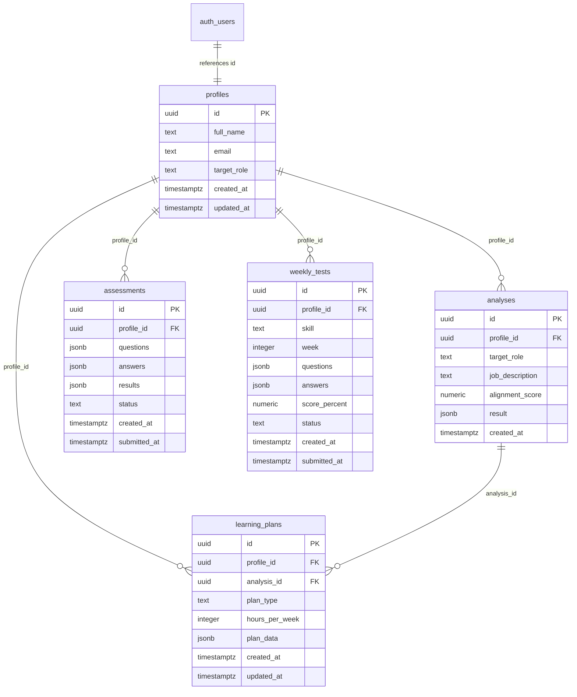

# SkillForge – Database Architecture & Supabase Schema

SkillForge utilizes **Supabase PostgreSQL** as its primary cloud data store. All tables are safeguarded with **Row Level Security (RLS)** policies ensuring multi-tenant isolation where each student can only access and modify their own records.

---

## 🗄️ Database Entity-Relationship Diagram (ERD)



---

## 📋 Schema Definition

The full DDL and migration script is stored in [`database/supabase_schema.sql`](file:///Users/maheshbasarkod/Documents/hackthon3/database/supabase_schema.sql).

### Key Tables
1. **`public.profiles`**: Extends `auth.users` with student career preferences, full name, and chosen target job role. Cascades on account deletion.
2. **`public.analyses`**: Stores resume text extraction metadata, extracted skills list, and Gemini AI coaching feedback.
3. **`public.assessments`**: Stores generated 20-MCQ technical exam sets, student submissions, and granular performance scores.
4. **`public.learning_plans`**: Holds the complete 14-week curriculum (70 daily tasks, milestones, and checkbox completion states).
5. **`public.weekly_tests`**: Tracks weekly quiz submissions and inputs to the adaptive curriculum engine.

---

## 🛡️ Row Level Security (RLS) & Security Policies

* Every table has RLS explicitly enabled (`ALTER TABLE ... ENABLE ROW LEVEL SECURITY`).
* Queries executed via the frontend client or authenticated API calls require `auth.uid() = profile_id`.
* The backend API interacts securely via isolated GoTrue clients and service role authentication for administrative maintenance tasks.

---

## ⚡ Performance Indexes

Composite indexes are configured for high-frequency queries:
```sql
CREATE INDEX idx_analyses_profile ON public.analyses(profile_id, created_at DESC);
CREATE INDEX idx_assessments_profile ON public.assessments(profile_id, created_at DESC);
CREATE INDEX idx_plans_profile ON public.learning_plans(profile_id, created_at DESC);
CREATE INDEX idx_weekly_tests_profile ON public.weekly_tests(profile_id, week, created_at DESC);
```
